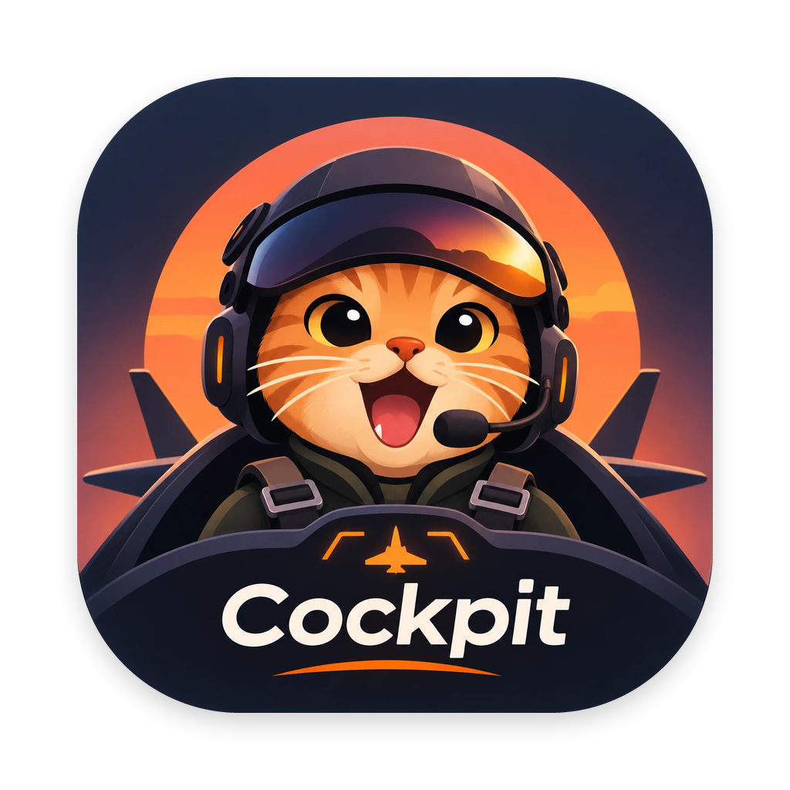
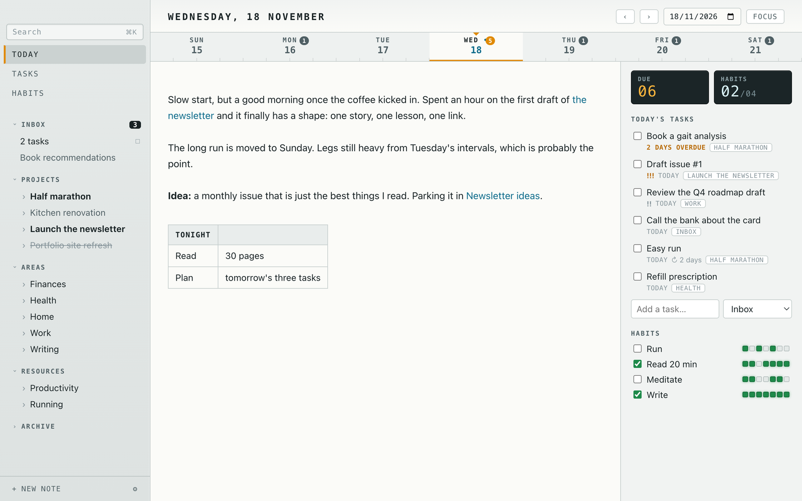
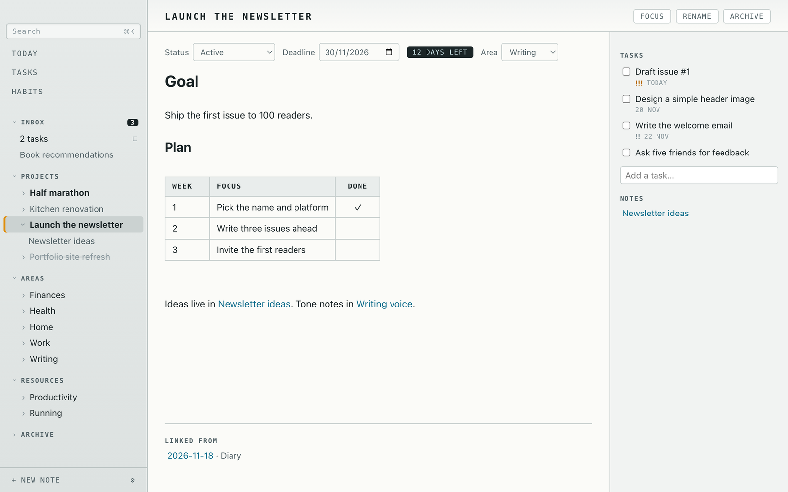
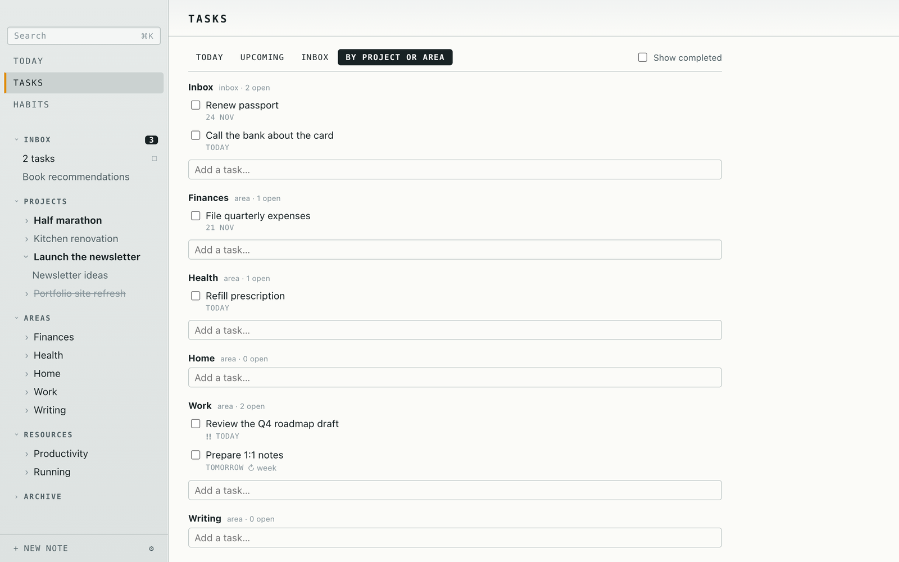
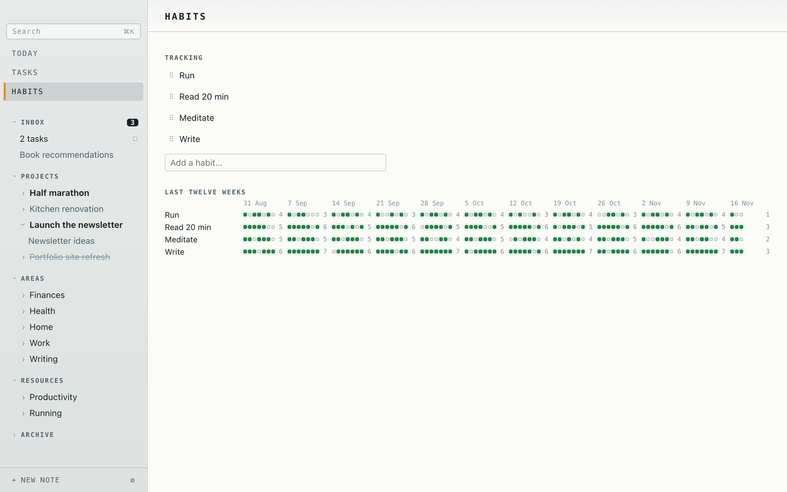
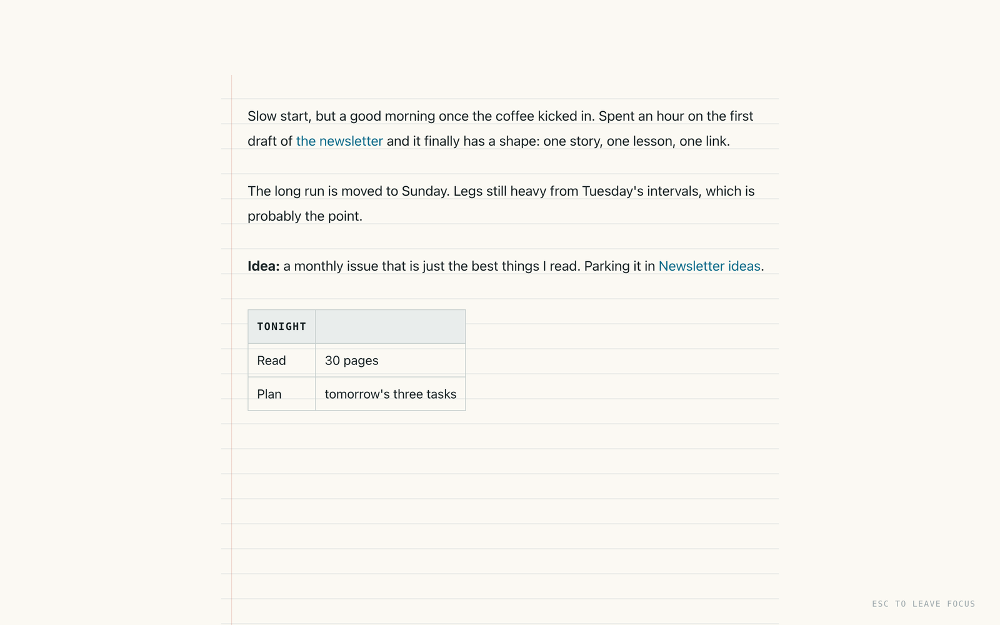
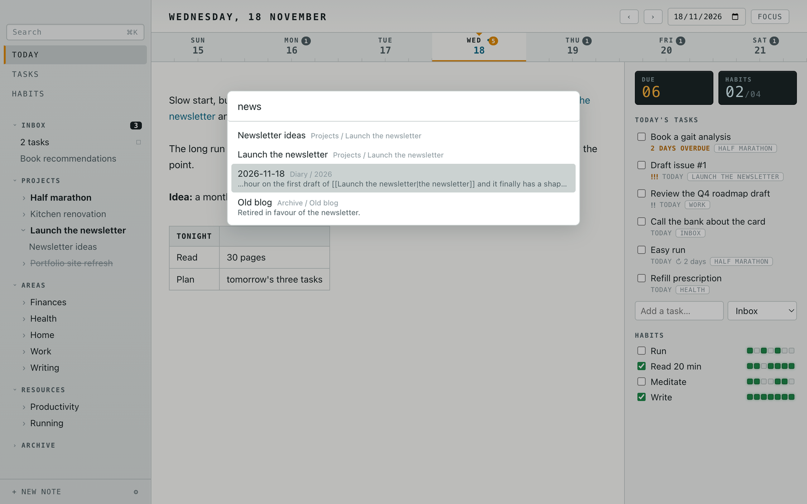

<p align="center">
  
</p>

<h1 align="center">Cockpit</h1>

<p align="center">
  A Mac app for running your life with the <b>PARA method</b>: a daily diary, notes, tasks, and habits,<br />
  all kept as plain markdown files in a folder you own.
</p>

<p align="center">
  
</p>

## Download

**[Download the latest version](https://github.com/bshikhar13/Cockpit/releases/latest)** from the Releases page:

| Your Mac | File |
|---|---|
| Apple Silicon (M1, M2, M3, M4 and later) | `Cockpit-<version>-arm64.dmg` |
| Intel | `Cockpit-<version>-x64.dmg` |

Not sure which you have? Apple menu  → **About This Mac**: "Chip: Apple M…" means Apple Silicon,
"Processor: Intel…" means Intel. Cockpit needs macOS 11 (Big Sur) or later.

To install, open the `.dmg` and drag **Cockpit** onto **Applications**.

**First launch.** Cockpit is free and not registered with Apple's paid developer programme, so the
first time you open it macOS will say it can't verify the app. This happens once:

- **macOS 15 (Sequoia) and later:** open Cockpit, click **Done** on the warning, then go to
  **System Settings → Privacy & Security**, scroll down, and click **Open Anyway** next to Cockpit.
- **macOS 14 (Sonoma) and earlier:** right-click Cockpit in Applications, choose **Open**, then
  click **Open** in the dialog.

After that it opens like any other app. The source is all here if you'd rather
[build it yourself](#getting-started).

## Built on PARA, by Tiago Forte

Cockpit is organised around **PARA**, a method created by productivity author
[Tiago Forte](https://fortelabs.com) of Forte Labs and described in his book *Building a Second Brain*.
Read the original explanation here:

> **[The PARA Method: The Simple System for Organizing Your Digital Life in Seconds](https://fortelabs.com/blog/para/)**
> by Tiago Forte, on fortelabs.com

PARA's core idea is to sort information by **how actionable it is**, not by what it's about.
Everything you keep falls into one of four places, from most to least actionable:

| | What it holds | In Cockpit |
|---|---|---|
| **P**rojects | Efforts with a goal and an end date | A folder per project, with a home note, its own tasks, a status (Active, To be picked up, Done), and a countdown to its deadline. Active projects stand out in bold. |
| **A**reas | Ongoing responsibilities with no end date | A folder per area (Health, Work, Finances…), with its notes and recurring tasks. Projects can belong to an area. |
| **R**esources | Topics of interest you may want later | Folders of reference notes, kept out of the way of anything due. |
| **A**rchive | Anything inactive from the other three | One click archives a whole project, area, or topic, and one click brings it back. Archived tasks drop out of every task list. |

Cockpit adds an **Inbox** in front of PARA for anything you haven't sorted yet, and a **daily diary**
as the place most things start: you write freely, and the work of filing comes after.

Cockpit is an independent project. It is not affiliated with or endorsed by Tiago Forte or Forte Labs.

## What's inside

### Today

The diary page for the day fills the screen. The rail on the right shows the tasks due that day,
overdue ones, and your habit ticks. A week strip across the top counts the tasks due on each day;
pick any day to see its page and its tasks.

### Projects and areas



Each project page shows its status, a countdown to its deadline, the area it belongs to, its open
tasks, and the other notes in its folder. Notes link to one another with `[[Note name]]`, and every
note lists what links to it.

### Tasks



Today, Upcoming, Inbox, and a view grouped by project and area. Tasks take a due date, a
priority, and a repeat rule. A repeating task ticked late makes one new task, never a backlog.
Tasks without a date never clutter Today.

### Habits



Yes-or-no trackers you fill in at the end of the day, with a twelve-week grid. No streaks, no
reminders, no guilt.

### Focus



Press **Focus** (or <kbd>⌘</kbd><kbd>⇧</kbd><kbd>F</kbd>) and everything but the page disappears,
onto a quietly lined sheet. <kbd>Esc</kbd> brings it all back.

### Search



<kbd>⌘</kbd><kbd>K</kbd> finds any note by title or by a word inside it.

### Also

- **Live-preview editor.** Markdown renders as you type: headings, lists, checkboxes, links,
  images, video. Tables are edited like a small spreadsheet; type `/table` to make one.
- **Shortcuts.** <kbd>⌘</kbd><kbd>1</kbd> Today, <kbd>⌘</kbd><kbd>2</kbd> Tasks,
  <kbd>⌘</kbd><kbd>3</kbd> Habits.
- **Optional encryption.** Encrypt the whole folder, names included, with a passcode asked at every
  launch and a recovery key. Your cloud provider sees only scrambled files.
- **Your files, not an app's database.** Opening a note never writes to it, and an edit changes only
  what you typed. If a file changes on disk while you're editing it, both versions are kept.

## Your notes are plain files

Point Cockpit at any folder. For Google Drive, pick one inside
`~/Library/CloudStorage/GoogleDrive-<account>/My Drive/` and set it to **Available offline**.
Without encryption, any markdown editor can read everything:

```
Diary/2026/2026-11-18.md     one file per day; habit ticks live in its frontmatter
Projects/<Name>/<Name>.md    a project's home note (status, deadline, area)
Projects/<Name>/Tasks.md     its tasks
Areas/<Name>/...             same shape, for ongoing areas
Resources/<Topic>/...        reference notes
Archive/...                  archived projects, areas, and topics
Attachments/                 images and video pasted or dropped into notes
Inbox/                       notes and tasks with no home yet
Habits.md                    the list of habits being tracked
```

Tasks use the [Obsidian Tasks](https://publish.obsidian.md/tasks/) format, so they stay readable
anywhere:

```
- [ ] Draft issue #1 📅 2026-11-18 ⏫ 🆔 nl0001
- [ ] Prepare 1:1 notes 🔁 every week 📅 2026-11-19 🆔 wk0002
```

The day ends at 4 am by default, so late-night writing belongs to the day that's ending. Change it
under the gear in the sidebar.

## Getting started

Requires macOS and Node.js 20.

```bash
npm install
npm run dev
```

To build the app for this Mac:

```bash
npm run package     # dist/mac-arm64/Cockpit.app
```

To build the downloadable disk images for Apple Silicon and Intel:

```bash
npm run dist        # dist/Cockpit-<version>-arm64.dmg and -x64.dmg
```

## Tests

```bash
npm test          # unit tests
npm run typecheck
npm run e2e       # builds, then drives the real app on a temporary folder
```

## Code layout

- `src/core`: pure logic for every file format (no Electron, no file access)
- `src/main`: the notes folder on disk, encryption, the index, the file watcher, and services
- `src/preload`: the bridge that exposes `window.cockpit`
- `src/renderer`: the React interface and the CodeMirror editor

## Roadmap

Cockpit is built in stages. This is stage 1. Next, in order: Google Calendar with automatic time
blocking, local-LLM agents and a chat over all your notes, a vault for web resources, and help
drafting posts from your own writing. The design is in
[docs/superpowers/specs](docs/superpowers/specs/2026-11-11-cockpit-design.md).

## Licence

MIT. See [LICENSE](LICENSE).

PARA and *Building a Second Brain* are the work of Tiago Forte and Forte Labs.
